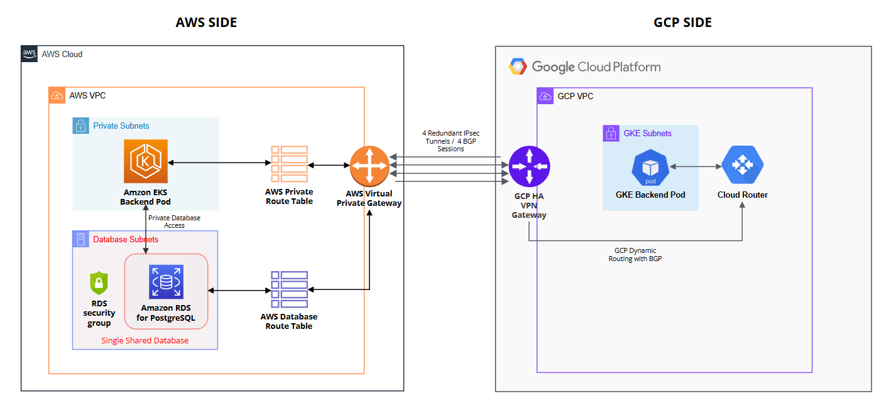
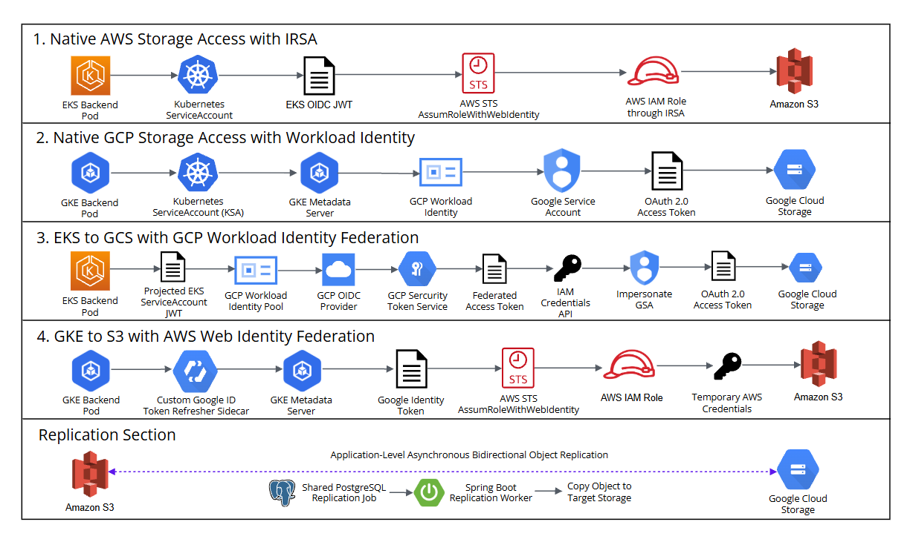
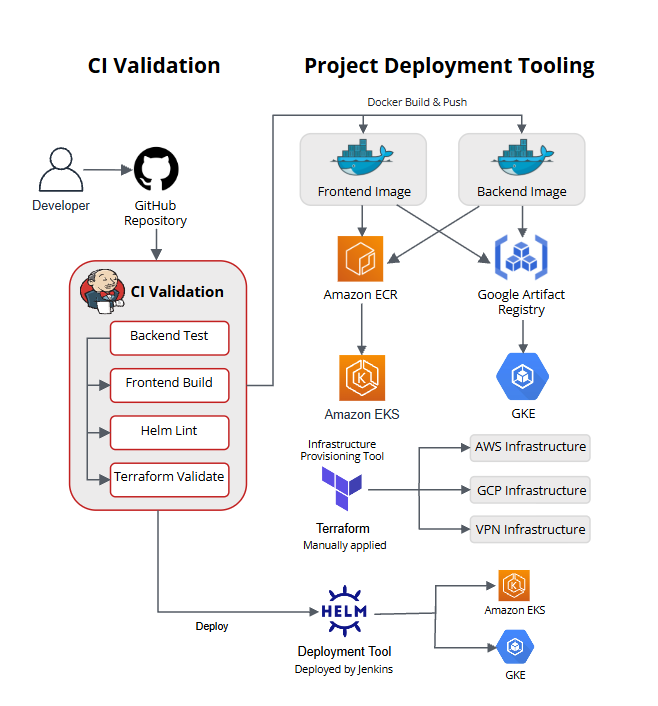

# 사진 저장소

1인 개발로 진행한 Spring Boot 기반 멀티클라우드 사진 저장 서비스 프로젝트입니다.

약 3개월간 진행했으며, AWS와 GCP에 Kubernetes 기반 배포 환경을 구축했습니다.

[](https://github.com/lty02-ops/Photo-storage/actions/workflows/ci.yml)

## 주요 기능

- Google, Naver, Kakao 소셜 로그인 기능
- 사진 업로드, 다운로드, 삭제 기능
- 사진 공유 링크 생성 기능
- 사진 업로드 및 목록 조회 기능
- 저장한 사진 다운로드 및 삭제 기능

## 사용 기술

### App


### Infra


### Cloud


## 아키텍처

### 멀티클라우드 네트워크와 공유 데이터베이스



AWS에는 EKS, S3, RDS로, GCP에는 GKE와 Cloud Storage로 구성했습니다. EKS와 GKE에는 같은 Spring Boot 백엔드와 React 프론트엔드가 올라갑니다.

AWS에서 업로드한 사진은 S3에 먼저 저장된 뒤 GCS로 복제하고, GCP에서 업로드한 사진은로 GCS에서 S3로 복제합니다.

### VPN과 데이터베이스

하나의 데이터베이스 AWS RDS PostgreSQL를 EKS와 GKE 두 곳에서 공유하도록 구성하였습니다.

EKS 백엔드는 AWS VPC 내부에서 RDS에 접근하고, GKE 백엔드는 VPN을 통해 RDS에 접근합니다.

GCP가 RDS에 접근하는 흐름은 다음과 같습니다.

```text
GKE Backend Pod → GCP VPC → GCP HA VPN Gateway
→ IPsec VPN Tunnel → AWS Virtual Private Gateway
→ AWS VPC → Amazon RDS PostgreSQL
```

AWS와 GCP의 안정적인 통신을 위해서 IPsec VPN 터널 4개와 각 터널에 대응하는 BGP 세션 4개를 구성하였습니다.

GCP Cloud Router와 AWS Virtual Private Gateway는 BGP를 통해 서로의 VPC 네트워크 경로를 교환합니다. AWS에서는 GCP VPC 경로를 Private Route Table과 Database Route Table에 반영하여 RDS에서 GKE로 응답 트래픽을 전달할 수 있도록 하였습니다

### 스토리지 권한



#### 멀티 클라우드 스토리지 인증

Pod 내부에 AWS Access Key나 GCP Service Account Key를 저장하지 않고, 각 클라우드의 임시 자격증명을 사용해서 스토리지에 접근할 수 있도록 구성했습니다.

- EKS에서 S3: IRSA
- GKE에서 GCS: GKE Workload Identity
- EKS에서 GCS: GCP Workload Identity Federation
- GKE에서 S3: Google Identity Token과 AWS STS

**EKS에서 GCS 접근**
EKS ServiceAccount JWT를 GCP STS에 전달하여 GCP가 이 토큰을 확인하면 GCP Service Account 권한의 Access Token을 받아 GCS에 접근하게 했습니다.

**GKE에서 S3에 접근**
Token Refresher Sidecar를 구성해서 Google Identity Token을 받아 파일로 저장합니다. 이후 AWS SDK가 이 파일을 읽고 `AssumeRoleWithWebIdentity`를 호출해 S3용 임시 자격증명을 받도록 했습니다.

#### 스토리지 간 비동기 복제

S3와 GCS간 사진 복제는 Spring Boot Worker를 이용하여 비동기로 처리하도록 구현했습니다.

사진을 각 클라우드에 맞는 저장소에 업로드한 후 PostgreSQL에 복제 작업을 저장하고 Worker가 해당 작업을 가져와서 다른 클라우드의 스토리지로 사진을 복제하도록 구성했습니다.

### CI 및 배포



GitHub Actions를 이용해 코드 변경 시 Backend Test, Frontend Build, Helm Lint, Terraform Validate를 실행하여 애플리케이션 코드와 배포 설정을 검증하도록 구성했습니다.

Frontend와 Backend는 각각 Docker 이미지로 빌드하여 AWS ECR과 Google Artifact Registry에 저장하고 EKS와 GKE에서 해당 이미지를 가져와 실행할 수 있도록 구성했습니다.

AWS와 GCP의 인프라 및 VPN 환경은 Terraform으로 관리하고 Kubernetes 애플리케이션 배포는 Helm을 사용했습니다.

Terraform을 이용한 인프라 변경과 Helm 배포는 GitHub Actions에서 자동으로 실행하지 않고 수동으로 구성했습니다.

## 설치 및 실행 방법

Docker와 Docker Compose가 설치된 환경에서 실행합니다. 로컬에서는 PostgreSQL과 로컬 파일 저장소를 사용하며, 클라우드 간 사진 복제는 비활성화됩니다.

```bash
git clone https://github.com/lty02-ops/Photo-storage.git
cd Photo-storage
cp infra/.env.example infra/.env
```

Windows PowerShell에서는 `Copy-Item infra/.env.example infra/.env`를 사용합니다.

`infra/.env`에 데이터베이스 비밀번호와 각 소셜 로그인 서비스에서 발급받은 Client 정보를 입력합니다.

```bash
cd infra
docker compose up --build
```

실행 후 http://localhost:3000 으로 접속합니다. 종료할 때는 `infra` 디렉터리에서 `docker compose down`을 실행합니다.

AWS·GCP 배포 절차는 [클라우드 배포](docs/deployment.md)를 참고합니다.

## Trouble Shooting

### GKE에서 S3 사진 복제 실패

| &nbsp;구&#8288;분&nbsp; | 내용 |
|---|---|
| &nbsp;문&#8288;제&nbsp; | GKE에서 사진 업로드는 됐지만 S3 복제 단계에서 `AssumeRoleWithWebIdentity` 오류가 발생했습니다. |
| &nbsp;원&#8288;인&nbsp; | IAM Role의 Trust Policy 조건이 Google Identity Token의 `aud`, `azp`, `sub` 값과 일치하지 않았습니다. |
| &nbsp;해&#8288;결&nbsp; | Trust Policy를 실제 토큰 값에 맞게 수정하여 Access Key 없이 S3에 접근하도록 했습니다. |

### GKE Load Balancer가 UNHEALTHY 상태

| &nbsp;구&#8288;분&nbsp; | 내용 |
|---|---|
| &nbsp;문&#8288;제&nbsp; | GCP Load Balancer의 외부 IP는 생성됐지만 Backend가 계속 `UNHEALTHY` 상태였습니다. Pod 로그에는 문제가 없어서 Service와 Health Check 설정을 다시 확인했습니다. |
| &nbsp;원&#8288;인&nbsp; | Service Port, BackendConfig, Health Check 설정이 맞지 않았습니다. |
| &nbsp;해&#8288;결&nbsp; | Service Port와 BackendConfig 연결을 맞추고 Health Check가 `/actuator/health`를 확인하도록 수정하니 HEALTHY로 바뀌었습니다. |

### VPN 연결 후 RDS 접근 실패

| &nbsp;구&#8288;분&nbsp; | 내용 |
|---|---|
| &nbsp;문&#8288;제&nbsp; | VPN Tunnel과 BGP 세션이 정상이라서 바로 통신될 것으로 생각했지만 GKE에서 RDS에 연결할 수 없었습니다. |
| &nbsp;원&#8288;인&nbsp; | AWS Route Table의 경로 전파와 RDS Security Group의 접근 허용 설정이 필요했습니다. |
| &nbsp;해&#8288;결&nbsp; | 확인해 보니 터널만 연결된 상태였고 AWS Route Table과 RDS Security Group 설정이 모두 끝난 것은 아니었습니다. VPN Gateway Route Propagation을 Private Route Table과 Database Route Table에 연결하고, RDS Security Group에서 GCP VPC 대역의 5432 포트를 허용해 해결했습니다. |


## 배운 점

- **클라우드 간 네트워크 연결:** AWS와 GCP를 VPN으로 연결하면서 터널이 정상이어도 데이터베이스에 바로 접속할 수 있는 것은 아니라는 점을 배웠습니다. BGP 경로 전파, Route Table, Security Group 등을 같이 확인하며 통신 경로를 구성했습니다.

- **서로 다른 클라우드의 자격 증명 교환:** EKS와 GKE에서 상대 클라우드의 스토리지에 접근하도록 구성하며, 각 클라우드가 발급한 토큰을 임시 자격 증명으로 교환하는 과정을 이해할 수 있었습니다. Google Identity Token의 `aud`, `azp`, `sub` 값과 AWS Trust Policy 조건을 비교하며 인증 실패 원인을 찾는 방법을 배웠습니다.

- **사진 업로드와 복제 작업 분리:** 사진을 기본 저장소에 업로드한 뒤 데이터베이스에 복제 작업을 저장하고 Worker가 처리하도록 구성했습니다. 이를 통해 반대쪽 저장소의 복제 실패가 원본 업로드에 미치는 영향을 줄이는 방법을 배울 수 있었습니다.

## 아쉬운 점

- **단일 데이터베이스 의존:** 애플리케이션과 스토리지는 AWS와 GCP 양쪽에 있지만 데이터베이스는 AWS RDS 하나를 공유하기 때문에 만약 RDS에 장애가 발생하면 장애에 대응하지 못합니다.

- **성능 검증 부족:** 기하급수적인 사진 업로드로 인하여 복제 작업이 동시에 다수 발생하면 전송 속도나 안정성에 문제가 생길 수 있습니다. 실제로는 사진 업로드가 많지 않아 성능 검증을 충분히 하지 못했습니다.


## 개발자

- GitHub: [lty02-ops](https://github.com/lty02-ops)
