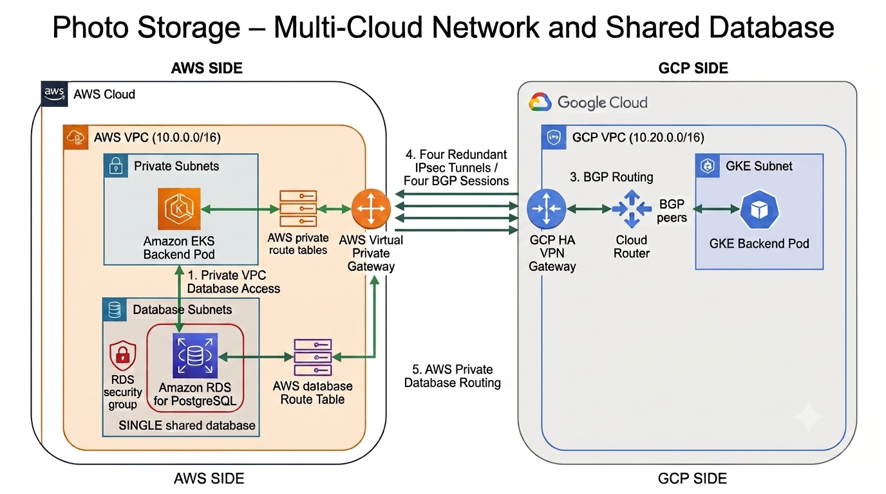
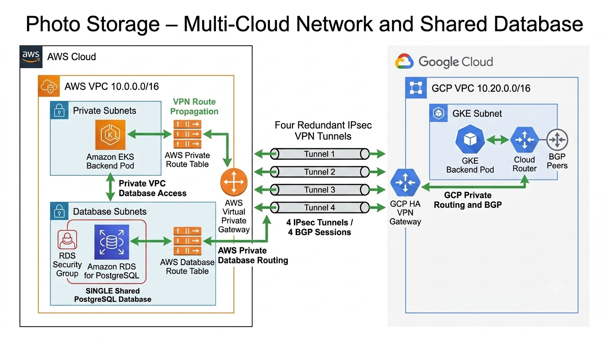
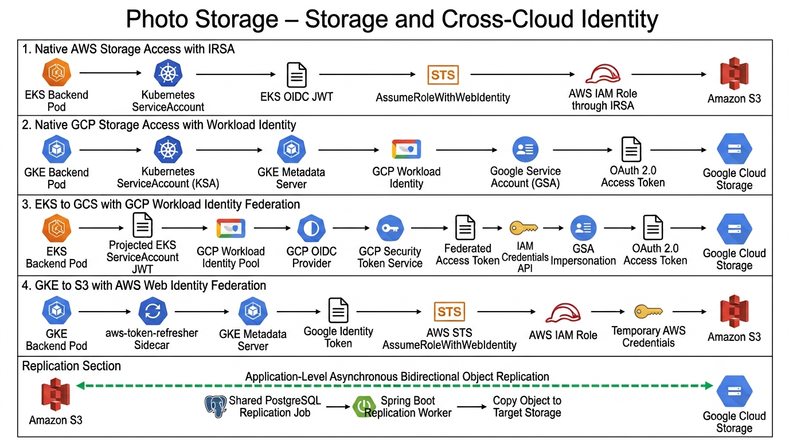
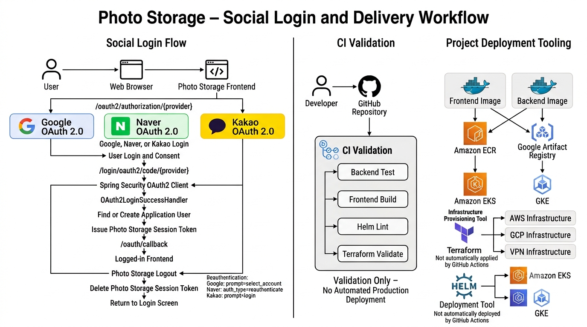

# Photo Storage

AWS와 GCP를 이용하여 비동기 사진 복제를 구현한 멀티클라우드 사진 저장 서비스입니다.

EKS와 GKE에 같은 애플리케이션을 배포하고 두 클라우드를 VPN으로 연결하여 구성하였습니다.

사진은 S3와 GCS에 저장하고, 사용자와 사진 정보는 하나의 PostgreSQL에서 관리합니다.

[](https://github.com/lty02-ops/Photo-storage/actions/workflows/ci.yml)

## 기능

- 이메일 및 소셜 로그인(Google, Naver, Kakao)
- 사진 업로드, 다운로드, 삭제
- 공유 링크 생성
- EKS와 GKE 배포
- S3와 GCS 간 비동기 사진 복제
- AWS와 GCP 간 Site-to-Site VPN 연결
- IRSA와 Workload Identity를 이용한 스토리지 권한 관리

## 아키텍처

### 전체 구성



AWS에는 EKS, S3, RDS를 두었고 GCP에는 GKE와 Cloud Storage를 구성했습니다. EKS와 GKE에는 같은 Spring Boot 백엔드와 React 프론트엔드가 올라갑니다.

AWS에서 업로드한 사진은 S3에 먼저 저장한 뒤 GCS로 복제하고, GCP에서 업로드한 사진은 반대로 GCS에서 S3로 복제합니다.

### VPN과 데이터베이스



데이터베이스를 클라우드별로 구성하면 별도로 데이터 동기화가 필요하기 때문에 AWS RDS PostgreSQL 하나를 EKS와 GKE 두 곳에서 공유하도록 구성하였습니다.

EKS 백엔드는 AWS VPC 내부에서 RDS에 접속하고, GKE 백엔드는 VPN을 통해 RDS에 접속합니다. 

연결 통로는 다음과 같습니다.

```text
GKE Backend Pod → GCP VPC → Cloud Router + BGP → GCP HA VPN Gateway → IPsec VPN Tunnel → AWS Virtual Private Gateway → AWS Database Route Table → Amazon RDS for PostgreSQL
```

HA VPN 구성을 위해 IPsec 터널 4개와 각 터널에 대응하는 BGP 세션 4개를 사용했습니다. AWS에서는 Virtual Private Gateway가 학습한 GCP VPC 경로가 Private Route Table과 Database Route Table에 전파되도록 설정했습니다.

### 스토리지 권한



Pod 안에 AWS Access Key나 GCP Service Account 키를 저장하고 싶지 않아 임시 자격증명을 사용했습니다.

- EKS에서 S3: IRSA
- GKE에서 GCS: GKE Workload Identity
- EKS에서 GCS: GCP Workload Identity Federation
- GKE에서 S3: Google Identity Token과 AWS STS

EKS에서 GCS에 접근할 때는 EKS ServiceAccount JWT를 GCP STS에 전달하여 GCP가 이 토큰을 확인하면 GCP Service Account 권한의 Access Token을 받아 GCS에 접근하게 했습니다.

GKE에서 S3에 접근할 때는 Sidecar가 Google Identity Token을 받아 파일로 저장하고 AWS SDK가 이 파일을 읽어 `AssumeRoleWithWebIdentity`를 호출해 S3용 임시 자격증명을 받도록 했습니다.

사진 복제는 스토리지에서 자동으로 처리하는 방식이 아니기 때문에 사진을 먼저 기본 저장소에 저장하고 PostgreSQL에 복제 작업을 남기면 Spring Boot Worker가 작업을 읽어 반대쪽 저장소로 복사하게 했습니다. 한쪽 스토리지에 문제가 생겨도 원본 업로드까지 같이 실패하지 않도록 이 방법으로 설계하였습니다.

### 로그인과 CI



소셜 로그인은 Spring Security OAuth2 Client로 구현했습니다. GitHub Actions에서는 백엔드 테스트, 프런트엔드 빌드, Helm Lint, Terraform Validate를 실행합니다.

GitHub Actions는 검증 용도로만 사용하였고 `terraform apply`나 Helm 배포는 자동으로 실행하지 않습니다.

## 사용 기술

### Application


### Infrastructure


### Cloud


- AWS: EKS, ECR, S3, RDS, ALB, IAM, STS, Site-to-Site VPN
- GCP: GKE, Artifact Registry, Cloud Storage, Load Balancer, IAM, HA VPN, Cloud Router

## 로컬 실행

환경변수 파일 생성

```bash
cp infra/.env.example infra/.env
```

`infra/.env`에는 다음과 같은 값을 입력하여 저장합니다.

```env
DB_PASSWORD=

GOOGLE_CLIENT_ID=
GOOGLE_CLIENT_SECRET=

NAVER_CLIENT_ID=
NAVER_CLIENT_SECRET=

KAKAO_CLIENT_ID=
```

소셜 로그인 Callback URL은 다음과 같습니다.

```text
Google: http://localhost:3000/login/oauth2/code/google
Naver:  http://localhost:3000/login/oauth2/code/naver
Kakao:  http://localhost:3000/login/oauth2/code/kakao
```

실행

```bash
cd infra
docker compose up --build
```

실행이 끝나면 http://localhost:3000 으로 접속합니다.

종료:

```bash
docker compose down
```

## 클라우드 배포 실행

예제 파일을 복사한 후 데이터베이스 비밀번호와 OAuth Client 정보를 입력합니다.

```bash
cp infra/helm/photo-storage/secret-values.example.yaml \
  infra/helm/photo-storage/secret-values.yaml
```

```yaml
backend:
  env:
    datasourcePassword: 실제_DB_비밀번호

  oauth:
    google:
      clientId: 실제_GOOGLE_CLIENT_ID
      clientSecret: 실제_GOOGLE_CLIENT_SECRET
    naver:
      clientId: 실제_NAVER_CLIENT_ID
      clientSecret: 실제_NAVER_CLIENT_SECRET
    kakao:
      clientId: 실제_KAKAO_CLIENT_ID
```

다음 Terraform 명령은 각 디렉터리로 이동하기 전 프로젝트 루트에서 실행합니다.

### AWS
```bash
cd infra/terraform/aws
terraform init
terraform plan
terraform apply
```

### GCP
```bash
cd infra/terraform/gcp
terraform init
terraform plan
terraform apply
```

### VPN (AWS <-> GCP)
```bash
cd infra/terraform/multicloud-network
terraform init
terraform plan
terraform apply
```

### Docker image push
프로젝트 루트에서 프론트엔드와 백엔드 이미지를 빌드합니다.
```bash
docker build -t photo-storage-frontend:latest ./frontend
docker build -t photo-storage-backend:latest ./backend
```

AWS ECR에 로그인합니다.

```bash
AWS_REGION=ap-northeast-2
AWS_ACCOUNT_ID=$(aws sts get-caller-identity --query Account --output text)

aws ecr get-login-password \
  --region $AWS_REGION \
  | docker login \
      --username AWS \
      --password-stdin \
      $AWS_ACCOUNT_ID.dkr.ecr.$AWS_REGION.amazonaws.com
```

ECR에 이미지를 push합니다.
```bash
docker tag photo-storage-frontend:latest \
  $AWS_ACCOUNT_ID.dkr.ecr.$AWS_REGION.amazonaws.com/photo-storage-frontend:latest

docker tag photo-storage-backend:latest \
  $AWS_ACCOUNT_ID.dkr.ecr.$AWS_REGION.amazonaws.com/photo-storage-backend:latest

docker push \
  $AWS_ACCOUNT_ID.dkr.ecr.$AWS_REGION.amazonaws.com/photo-storage-frontend:latest

docker push \
  $AWS_ACCOUNT_ID.dkr.ecr.$AWS_REGION.amazonaws.com/photo-storage-backend:latest
```

Google Artifact Registry에 로그인합니다.
```bash
GCP_REGION=asia-northeast3
GCP_PROJECT_ID=$(gcloud config get-value project)

gcloud auth configure-docker \
  $GCP_REGION-docker.pkg.dev
```

Artifact Registry에 이미지를 Push합니다.

```bash
docker tag photo-storage-frontend:latest \
  $GCP_REGION-docker.pkg.dev/$GCP_PROJECT_ID/photo-storage/photo-storage-frontend:latest

docker tag photo-storage-backend:latest \
  $GCP_REGION-docker.pkg.dev/$GCP_PROJECT_ID/photo-storage/photo-storage-backend:latest

docker push \
  $GCP_REGION-docker.pkg.dev/$GCP_PROJECT_ID/photo-storage/photo-storage-frontend:latest

docker push \
  $GCP_REGION-docker.pkg.dev/$GCP_PROJECT_ID/photo-storage/photo-storage-backend:latest
```


### EKS 배포
```bash
aws eks update-kubeconfig \
  --region ap-northeast-2 \
  --name photo-storage-eks

helm upgrade --install photo-storage \
  infra/helm/photo-storage \
  -f infra/helm/photo-storage/values-aws.yaml \
  -f infra/helm/photo-storage/secret-values.yaml
```

### GKE 배포
```bash
gcloud container clusters get-credentials photo-storage-cluster \
  --region asia-northeast3 \
  --project $GCP_PROJECT_ID

helm upgrade --install photo-storage \
  infra/helm/photo-storage \
  -f infra/helm/photo-storage/values-gcp.yaml \
  -f infra/helm/photo-storage/secret-values.yaml
```

### 배포 확인
```bash
kubectl get pods
kubectl get services
kubectl get ingress
```

## 작업하면서 해결한 문제

### GKE에서 S3로 복제되지 않았던 문제

GKE에서는 사진 업로드가 됐지만 S3 복제 단계에서 `AssumeRoleWithWebIdentity` 오류가 발생했습니다.

처음에는 S3 Policy를 확인했는데 S3 권한 자체는 문제가 없었으며, Google Identity Token을 확인해 보니 IAM Role의 Trust Policy에 설정한 조건과 토큰의 `aud`, `azp`, `sub` 값이 맞지 않았습니다. Trust Policy를 실제 토큰 값에 맞게 수정하였고 Access Key 없이 S3에 접근할 수 있었습니다.

이때 IAM Policy뿐 아니라 Role을 맡을 수 있는 대상을 정하는 Trust Policy도 같이 봐야 한다는 것을 알게 됐습니다.
<br>

### GKE Load Balancer가 UNHEALTHY로 나온 문제

GCP Load Balancer의 외부 IP는 생성됐지만 Backend가 계속 `UNHEALTHY` 상태였습니다. Pod 로그에는 문제가 없어서 Service와 Health Check 설정을 다시 확인했습니다.

Service Port와 BackendConfig 연결을 맞추고 Health Check가 `/actuator/health`를 확인하도록 수정하니 HEALTHY로 바뀌었습니다.

### VPN은 연결됐는데 RDS에 접속되지 않았던 문제

VPN Tunnel과 BGP 세션이 정상이라서 바로 통신될 것으로 생각했지만 GKE에서 RDS에 연결할 수 없었습니다.

확인해 보니 터널만 연결된 상태였고 AWS Route Table과 RDS Security Group 설정이 모두 끝난 것은 아니었습니다. VPN Gateway Route Propagation을 Private Route Table과 Database Route Table에 연결하고, RDS Security Group에서 GCP VPC 대역의 5432 포트를 허용해 해결했습니다.
<br>

### Terraform Destroy 중 VPC가 삭제되지 않은 문제

테스트 후 `terraform destroy`를 실행했을 때 VPC에 연결된 리소스가 남아 있다는 오류가 발생했습니다.

Kubernetes Ingress가 만든 Load Balancer와 Security Group은 Terraform 코드에서 직접 만든 리소스가 아니어서 같이 정리되지 않았습니다. Helm 리소스와 Load Balancer를 먼저 제거하고, 남아 있는 스토리지 객체와 네트워크 의존성을 확인한 뒤 다시 삭제했습니다.
<br>

## 현재 아쉬운 점

애플리케이션과 스토리지는 AWS와 GCP 양쪽에 있지만 데이터베이스는 AWS RDS 하나입니다. 그래서 한쪽 애플리케이션에 문제가 생겼을 때 다른 쪽을 사용할 수는 있어도, RDS에 장애가 생기면 두 환경이 모두 영향을 받게 됩니다.

## 개발자

- GitHub: [lty02-ops](https://github.com/lty02-ops)
